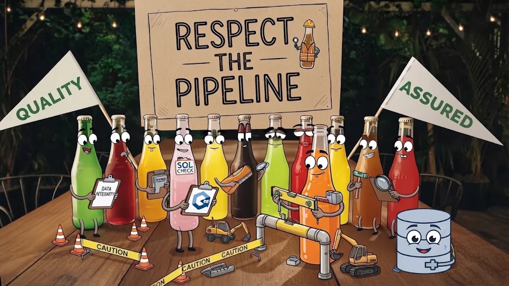
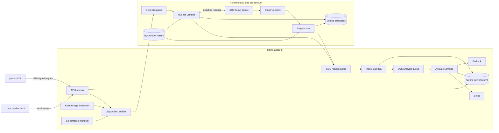

# Jarritos



A serverless, AWS-native, self-hosted data quality and observability platform built on the free public Soda Core v4 packages and reladiff, driven by YAML configuration.

Moving data between sources and destinations is still a core part of data engineering, and the data is only worth having if it arrives complete, correct and on time. Jarritos is meant to check that. It enforces contracts on each table, tracks metrics over time to catch freshness, volume and schema problems, and compares a source with its destination down to the row and column.

Fixed thresholds and hand-written tests do not scale to thousands of tables, so the AI features are a core part of the design. An agent proposes the metrics and tests for each table, and another agent looks at each anomaly and decides whether it is a real issue or a false positive, so people review fewer alerts. The prompts, tools, traces and model are yours to inspect and change, and jarritos still runs without a model, with triage falling back to detector agreement.

## Status

Jarritos is at the design stage. Nothing is implemented yet: there is no released code, no installable package and no deployable infrastructure. Every feature in this document is planned, and the YAML, CLI and architecture shown here are the current design, which may change.

The scale target is about 5,000 datasets across several teams and several AWS accounts. It is a design target. It has not been load tested, and no performance or cost figure in this document has been measured. A load test is planned for the end of milestone M2.

Several facts the design depends on are still unconfirmed. They are listed under [Open questions](#open-questions) and will be settled in milestone M0.

Contents:

- [What jarritos is](#what-jarritos-is)
- [How it differs from Soda Cloud](#how-it-differs-from-soda-cloud)
- [What the agents do](#what-the-agents-do)
- [Planned MVP features](#planned-mvp-features)
- [Source support tiers](#source-support-tiers)
- [Architecture](#architecture)
- [Configuration model](#configuration-model)
- [CLI reference](#cli-reference)
- [Agents](#agents)
- [Security and data exposure](#security-and-data-exposure)
- [Local development with Docker](#local-development-with-docker)
- [Local UI](#local-ui)
- [Cost](#cost)
- [Licensing](#licensing)
- [Dependency risks and adapters](#dependency-risks-and-adapters)
- [Known limits](#known-limits)
- [Open questions](#open-questions)
- [Roadmap](#roadmap)

## What jarritos is

Jarritos is meant to give data teams contract enforcement, metric monitoring, source-to-destination reconciliation and anomaly triage on top of two open source libraries: Soda Core v4 for data contracts, and reladiff for row-level diffs between tables. It is configured with YAML files kept in git, and it runs in the AWS accounts of the team that deploys it.

It targets these problems:

- Soda Core verifies contracts. Without Soda Cloud it has no observability: no metrics history, no monitoring over time and no anomaly detection.
- Soda's reconciliation checks need an Enterprise license.
- Writing contracts and monitors by hand for thousands of tables is slow, and most teams never finish.
- Fixed thresholds on metrics need tuning, and someone has to decide whether each anomaly is a real issue or a false positive.
- Teams with sources in several AWS accounts, and several thousand tables, need scheduling, isolation between teams and cost control for the warehouses being queried.

## How it differs from Soda Cloud

- It is self-hosted in your own AWS accounts. There is no SaaS component and no license fee.
- It has no paid features. Jarritos uses only the free public Soda Core v4 packages.
- It adds observability on top of Soda Core: metrics history, monitors, freshness, volume, schema change tracking and anomaly detection.
- It has row-by-row, column-by-column diff without an Enterprise license, computed with hashes inside the databases by reladiff.
- Contracts are plain Soda contract files, restricted to the free subset of check types.
- The AI is inspectable. Prompts, tool definitions, traces and the model choice belong to you, and traces are stored in your S3 bucket and your database.
- Agents propose metrics and tests for new tables, and they triage anomalies to separate real issues from false positives. Both run on a model you choose, such as Bedrock, and triage falls back to a deterministic rule when no model is available.
- The same YAML runs with the CLI, in Docker Compose, in CI and in AWS.

## What the agents do 🤖

Two agents are planned. Both are built with LangGraph, both are optional, and jarritos runs contracts, monitors, diffs and detectors with them turned off.

The suggest agent proposes metrics and tests. Given a table, it profiles the data, proposes contract checks and monitors, checks its own proposal with `jarritos validate`, and fixes the errors it finds. The output is a YAML diff that goes through git review. It is never applied automatically. `jarritos discover` runs it across a whole schema, so onboarding hundreds of tables does not mean writing hundreds of files by hand.

The triage agent decides whether an anomaly is a real issue or a false positive. Detectors flag statistical outliers, and many outliers are harmless: a holiday dip in volume, a backfill, a planned schema change, a weekly batch that arrived late. For each incident the agent reads the metric history and related metrics, schema changes, run history, a calendar and past verdicts, and it can rerun a detector with another window or sensitivity. It returns `real`, `false_positive` or `uncertain`, with a confidence, a rationale and a suggested action. The verdict is stored with the incident, and `jarritos anomalies` and the UI show it.

The triage agent learns from people. Labeling an anomaly with `jarritos anomalies resolve --false-positive` stores the label, and labels feed suppression rules and the examples the agent sees on later incidents.

Several limits apply to both agents. They read only the jarritos store and never query source databases. Values from text columns and from `sensitive` columns never reach a prompt. Cost caps apply per namespace and globally, and a model error, timeout or budget breach routes to the deterministic fallback. Prompts are versioned files in the repo, and every run records the model, prompt version, tool calls and output. The [Agents](#agents) section has the details.

## Planned MVP features
- Soda contracts are verified with Soda Core, and the measurements they produce are saved to the metrics history. A run can gate a pipeline.
- Built-in metrics are `row_count`, `null_count`, `null_pct`, `min`, `max`, `avg`, `median`, `percentile(p)`, `sum`, `stddev`, `distinct_count`, `duplicate_pct` and text length statistics. Custom SQL metrics return one number, with optional group-by and a cap on the number of groups. Monitors scan only new data by default when the dataset has a timestamp or partition column.
- Freshness comes from table metadata or from the maximum of a timestamp column, with custom thresholds (`warn_after`, `fail_after`), a cron-aware expected arrival time, a grace period and per-weekday overrides. Volume monitors cover row count, row count change and partition row count.
- Each metadata sweep snapshots the columns and records typed changes (added, dropped, type changed, nullability changed) with a configurable severity.
- Source and destination are compared at L1 (column names and types, using a canonical logical type system), L2 (aggregates such as row counts, sums, null counts, min and max, with tolerances) and L3 (row diff).
- Row-by-row and column-by-column diff uses reladiff, in `window`, `incremental` or `full` mode. A diff reports rows only in the source, rows only in the target and changed rows, with a mismatch count per column and example rows. Athena, which reladiff does not support, gets a same-engine join diff built by jarritos.
- Metric points are stored in an internal database: SQLite for single-process CLI runs, PostgreSQL in Docker Compose, and Aurora Serverless v2 PostgreSQL in AWS.
- CloudWatch is the default sink. Datadog is optional. Alerts can go to SNS, Slack and webhooks.
- Several detectors score each metric and return an expected range. A LangGraph triage agent reviews each incident with the surrounding history, schema changes, calendar and past human labels, and returns a verdict of real issue, false positive or uncertain, with a confidence and a rationale. Human labels feed back into suppression rules.
- A second LangGraph agent, the suggest agent, profiles a table and proposes metrics and tests as a YAML diff. It validates its own output before presenting it, and a person reviews the diff in git. `jarritos discover` runs it across a whole schema to onboard tables in bulk.
- Agents run on Bedrock by default or on any OpenAI-compatible endpoint. When no model is available, triage falls back to a deterministic rule based on detector agreement.
- Failures and anomalies open incidents with states `open`, `acknowledged` and `resolved`. Related incidents are grouped, and an incident resolves itself when its check recovers.
- A run ends as `passed`, `warned`, `failed`, `errored` or `skipped`. `errored` means the check could not run, and it never counts as a pass. A pipeline gate blocks on `errored` by default.

## Source support tiers

The tiers are taken from the documentation of Soda Core and reladiff. Milestone M0 will confirm each tested source with a real connection.

| Tier | Sources | What works |
|---|---|---|
| A | PostgreSQL (including Aurora, RDS and Supabase), Redshift, Snowflake, DuckDB, Trino. BigQuery and Databricks, which reladiff marks as implemented but not thoroughly tested. | Every feature: contracts, monitoring and row diff. |
| B | Athena, SQL Server, Fabric, Synapse, Dremio | Contracts and monitoring. Reconciliation without the reladiff row diff, because reladiff has no driver for these. Athena gets a jarritos-built same-engine join diff in M3. The others get L1 and L2 only. |
| C | MySQL and Oracle (the Soda packages are paid). Presto, Vertica and ClickHouse (Soda has no package). | Monitoring and reconciliation including row diff, with no Soda contracts. |
| Unknown | MariaDB, SAP HANA | They appear in Soda's data source table, but the documentation does not say whether their packages are free. |
| Out of scope | Spark DataFrame, Pandas, Polars | In-memory sources. |

The sources tested in CI will be PostgreSQL, Redshift, Snowflake and Athena, plus DuckDB for local runs. Every other source is supported but community tested.

`jarritos validate` will report the tier of each datasource and fail configs that ask for a feature the tier lacks.

## Architecture 🏗️

Jarritos spreads across one home account and one or more runner accounts.

The home account is where jarritos itself is installed. It holds the compiled config, the metrics store, the API, the scheduler, analysis and alert sinks. People and pipelines talk to this account.

A runner is the stack that queries your databases. You deploy one per AWS account, VPC or region that has sources. Credentials stay in that account; only check results cross back to the home account. The home account also gets a runner, so a first install can be a single account.



EventBridge has one schedule per distinct cron expression per namespace, not per dataset. The dispatcher looks up the datasets due and sends one job message per dataset to that runner's SQS queue, with a per-dataset jitter so runs do not all start on the minute. The job key is dataset plus scheduled time. A duplicate is dropped, and a run is skipped if the previous run of the same dataset is still going.

A runner takes a lease from a DynamoDB table (a conditional write with an expiry) before it connects to a source. With no lease free, the job is re-queued with a delay. Step Functions `MaxConcurrency` only limits iterations inside one Map state of one execution, so it cannot enforce this limit.

Light jobs go from SQS straight to the Runner Lambda. SQS provides retries, a dead-letter queue and a concurrency cap per runner. `compute: auto | lambda | fargate` applies to every job type, because one slow warehouse query can pass 15 minutes. A runner sets its own deadline below the Lambda limit, cancels the query and re-queues the job as heavy. Heavy jobs run on ECS Fargate behind a `HeavyRunner` interface, with AWS Batch as a later option if job volume needs it. Step Functions is used only for heavy jobs, where it waits on Fargate with `ecs:runTask.sync`. Running every light job through it at hourly schedules would bill about a million state transitions a day for single-step work.

Aurora Serverless v2 PostgreSQL is reached through the Data API. Only the Ingest and Analyze Lambdas and the API touch it. Runners send results to the results queue, which absorbs bursts and lets the Ingest Lambda write in batches. `metric_points` is partitioned by month. Raw points are kept for a set period, then rolled up to daily values and archived to S3 as Parquet. Reads are paginated because the Data API ends any call that returns more than 1 MiB. The store only does inserts and range reads. That keeps three store implementations behind one port: SQLite for `jarritos run --local`, PostgreSQL for the Docker Compose stack, and Aurora through the Data API in AWS.

Capped diff detail and agent traces go to S3 under a namespace prefix.

The home and runner stacks are Terraform modules, written to work with OpenTofu too and tested with both in CI. Container images are built and published to ECR by the release pipeline, and the modules take an image digest as input, so a deploy never builds code. Each account keeps its own Terraform state. Modules are versioned, and the home account accepts runners from a compatible range of versions. Job and result messages carry a schema version, and each runner reports its software version, so the home account can refuse an incompatible runner. Terraform owns infrastructure only. `jarritos deploy` owns dataset configuration and schedules, so a YAML change does not need a Terraform apply.

`jarritos deploy` validates the config, resolves defaults and writes an immutable compiled manifest per namespace to S3. `jarritos plan` shows the difference first. Each namespace deploys on its own, so one team's repo cannot change another team's config or schedules. Every run records the manifest version it used.

Three engines sit behind adapters. `ContractEngine` wraps Soda Core's `verify_contract_locally`. `DiffEngine` wraps reladiff. `QueryRunner` is jarritos's own thin layer for raw SQL, generated with sqlglot, and it reuses the drivers the two libraries install. One runner image holds Soda Core, reladiff and the drivers, and a smaller image serves the home-account Lambdas.

The Terraform modules will ship alarms for dead-letter queues, queue age, errored-run rate and missed runs (a dataset with no completed run within a multiple of its schedule).

Jarritos will emit `Config Deployed`, `Run Completed`, `Contract Verified`, `Metric Collected`, `Schema Changed`, `Freshness Violated`, `Reconciliation Completed`, `Anomaly Detected`, `Anomaly Triaged`, `Incident Opened` and `Incident Resolved`. Event names are Proper Case and past tense, properties are `snake_case`, and any stream or lake path uses the `snake_case` form of the name.

### Metadata sweep and metric collection

One job per datasource per tick reads row counts, last-modified times and column definitions for every monitored table from the system tables. Volume, metadata freshness and schema tracking for thousands of tables then cost a few queries.

Column metrics need a table scan. An incremental scan reads only the newest window or partition. Jarritos will use one batched query per dataset where the dialect allows it. Every query carries the datasource's statement timeout and a query tag with namespace, dataset and run ID, so warehouse admins can attribute cost. Median and percentiles need per-dialect SQL. Where a source has no exact function, the approximate one is used and the metric point records that. Backfill computes past values by windowing on the timestamp column. For late-arriving data there is a per-dataset wait before a period is analysed, and a recollect of the previous period.

Every metric point has `data_time` (the period the data covers) and `collected_at`. Every check and metric has a stable ID of the form `namespace/dataset/column/metric/qualifier`.

### Reconciliation and row diff

Reladiff has no sampling option, so samples are `where` filters applied to both sides: a time window, a key range, or a modulo on an integer key. L2 aggregates run first. A full diff runs only when they disagree or the user asks.

- `incremental` mode diffs only rows changed since the last successful diff, using an update column as the watermark. This is meant to keep daily reconciliation of large tables affordable.
- Same-database pairs use reladiff's join diff. Cross-database pairs use its hash diff.
- Reladiff returns `+` and `-` rows. Jarritos pairs them by key into rows only in the source, rows only in the target, and changed rows.
- Two Athena tables use a `FULL OUTER JOIN` on the key, generated with sqlglot, with Athena writing the differences to S3. A database source against an Athena target is a cross-engine pair. It needs a bucketed checksum diff, which is reladiff's own algorithm, and whether it ships in M3 depends on an M0 spike.
- Athena bills per data scanned and has a concurrent query quota, so Athena diffs require partition filters on large tables and run the L2 aggregates first.
- Guards are a difference cap, a timeout, a thread count and a warning when the difference ratio is high.
- A summary row goes to the store. Capped detail goes to S3 as Parquet.

### Anomaly detection and incidents

Detectors are plain Python functions with one interface, and each returns a score and an expected range. The MVP set is a robust z-score (median and MAD), a seasonal baseline (day-of-week and hour-of-week) and level-shift detection. Freshness uses the same detectors on arrival gaps. Detectors answer whether a value is unusual. They do not answer whether it matters, and the [triage agent](#triage-graph) takes that question for each incident. Until a metric reaches its minimum history, only fixed thresholds apply. Detectors keep a small baseline state per metric, so they do not re-read the full history on every run.

An incident has a dedup key (dataset plus check). Notifications fire on state changes, with a re-notify interval. Incidents on the same datasource in the same window, or linked by `depends_on`, are grouped into one.

## Configuration model

Config is split into small kinds, validated with a published JSON Schema that editors and agents both use. Every file has a schema `version`.

The examples below are illustrative draft shapes. Field names and structure may change before the first release.

The kinds are:

- `namespace`: a team or domain that owns datasets, notification routes and access rules.
- `runner`: the account, region and queue of a runner stack.
- `datasource`: type, runner, a secret reference and limits.
- `dataset`: a table with its owner, tags, schedule and references to the blocks below. Defaults come from the datasource and from tags, so thousands of tables do not need thousands of hand-written files.
- `columns`: an optional `classification` per column, such as `sensitive`, used by the data exposure policy.
- `contract`: an unmodified Soda contract file.
- `monitors`: time series collected by jarritos.
- `schema_tracking`: severity per change type.
- `reconciliation`: source, target and the three levels.
- `depends_on`: optional upstream datasets, used to group related incidents.
- `anomaly_policy`: detectors and their settings.
- `notifications`: routing by namespace, severity and tag.

A contract is a pass or fail assertion that can gate a pipeline. A monitor is a time series that can alert. Values measured during contract runs are also saved to history.

### Namespace

```yaml
version: 1
kind: namespace
name: payments
```

### Runner

```yaml
version: 1
kind: runner
name: payments-prod-account
account_id: "111111111111"
region: us-east-1
queue: payments-prod-jobs
```

### Datasource

```yaml
version: 1
kind: datasource
name: warehouse
type: postgres
runner: payments-prod-account
secret: arn:aws:secretsmanager:us-east-1:111111111111:secret:warehouse-ro
limits:
  max_concurrent_jobs: 2
  statement_timeout: 300s
  query_tag: jarritos
defaults:
  on_error: block
```

### Dataset

```yaml
version: 1
kind: dataset
datasource: warehouse
table: analytics.orders
owner: payments-data-team
tags: [finance, tier1]
schedule: "0 * * * *"
timestamp_column: updated_at
on_error: block
columns:
  customer_email:
    classification: sensitive
contract: contracts/orders.yml
monitors: orders-monitors
reconciliation: orders-vs-source
anomaly_policy: default
```

### Contract

The contract is a standard Soda contract file, with no jarritos-specific keys.

```yaml
dataset: warehouse/analytics/public/orders

checks:
  - schema:
  - row_count:
  - freshness:
      column: updated_at
      threshold:
        unit: hour
        must_be_less_than: 24

columns:
  - name: id
    checks:
      - missing:
  - name: customer_id
    checks:
      - missing:
          threshold:
            metric: percent
            must_be_less_than: 1
  - name: status
    checks:
      - invalid:
          valid_values: ['pending', 'paid', 'shipped', 'cancelled']
```

### Monitors

```yaml
version: 1
kind: monitors
name: orders-monitors
scan: incremental
metrics:
  - row_count
  - null_pct: { column: customer_id }
  - percentile: { column: amount, p: 95 }
  - custom_sql:
      name: refunds_total
      query: select sum(amount) from analytics.refunds
freshness:
  warn_after: 2h
  fail_after: 6h
  grace_period: 15m
volume:
  - row_count_change
anomaly_policy: default
export: false
```

### Reconciliation

```yaml
version: 1
kind: reconciliation
name: orders-vs-source
source: { datasource: oltp, table: public.orders }
target: { datasource: warehouse, table: analytics.orders }
key: [id]
levels:
  l1: true
  l2:
    checks: [row_count, sum(amount), null_count(customer_id)]
    tolerance: 0.001
  l3:
    mode: incremental
    update_column: updated_at
    min_age: 30m
    max_differences: 10000
```

### Anomaly policy

```yaml
version: 1
kind: anomaly_policy
name: default
detectors: [robust_zscore, seasonal_baseline, level_shift]
sensitivity: medium
seasonality: [day_of_week, hour_of_week]
min_history: 14d
agent_triage: on
suppress:
  - cron: "0 2 * * 0"
    duration: 3h
```

### Notifications

```yaml
version: 1
kind: notifications
namespace: payments
routes:
  - match: { severity: fail, tags: [tier1] }
    sinks: [slack, sns]
  - match: { severity: warn }
    sinks: [slack]
```

## CLI reference

This is the planned command set. `jarritos run --local` and `jarritos run --remote` use the same engine.

| Command | Purpose |
|---|---|
| `jarritos init` | Initialize a jarritos project. |
| `jarritos validate` | Validate config against the JSON Schema, report each datasource's tier, and reject excluded Soda features. |
| `jarritos plan` | Show the difference between the repo's config and the deployed manifest. |
| `jarritos deploy` | Validate, resolve defaults and write the compiled manifest for a namespace. |
| `jarritos run` | Run checks, monitors or diffs locally (`--local`), remotely (`--remote`), or wait for a remote result in a pipeline gate (`--wait`). |
| `jarritos history` | Show past runs, check results and metric values. |
| `jarritos schema diff` | Show schema changes between snapshots. |
| `jarritos diff` | Run a reconciliation or a row diff between two tables. |
| `jarritos incidents` | List and manage incidents. |
| `jarritos anomalies` | List anomalies and their triage verdicts, and label false positives with `resolve --false-positive`. |
| `jarritos profile` | Profile a table. |
| `jarritos suggest` | Propose metrics and tests for a table as a YAML diff. |
| `jarritos discover` | Run suggest across a whole schema to onboard tables in bulk. |
| `jarritos ui` | Start the read-only local UI. |

## Agents

The agents are written with LangChain and LangGraph (`langgraph`, `langchain-core` and `langchain-aws`, all MIT). Jarritos does not use LangSmith or LangGraph Platform.

Model access goes through a `get_chat_model()` factory that reads config. Bedrock is the default, and any OpenAI-compatible endpoint is optional. The MVP has no checkpointer, because triage runs are short and idempotent, so a failed run is rerun.

### Triage graph

The triage graph decides whether an anomaly is a real issue or a false positive. It runs once per incident, not once per anomaly. Its nodes are `gather_context`, `investigate`, `verdict`, `guardrails` and `persist`.

`investigate` is a bounded tool loop. Its tools read only the jarritos store: metric history and related metrics, schema changes, run history, a calendar, past verdicts and human feedback, and `rerun_detector` with a different window or sensitivity. Agents never query source databases.

`verdict` is structured output: `real`, `false_positive` or `uncertain`, with a confidence, a rationale and a suggested action. On an LLM error, a timeout or a budget breach, a conditional edge routes to a deterministic fallback based on detector agreement.

An upstream outage can flag thousands of metrics at once. Triage is fed by the analysis queue with a concurrency cap, and grouping collapses a storm into a few incidents before any model call. Bedrock throttling triggers backoff, then the fallback.

An illustrative verdict, as stored with an incident:

```yaml
dataset: payments.orders
check: row_count
verdict: false_positive
confidence: 0.86
rationale: Row count dropped 41% on a public holiday. The last two holidays showed the same drop, and no schema change or failed run came before it.
suggested_action: Add a calendar suppression for this dataset.
```

### Suggest graph

The suggest graph proposes metrics and tests. Its nodes are `profile`, `rule_proposals`, `llm_refine`, `validate` and `emit_yaml`. `profile` collects column statistics, `rule_proposals` turns the profile into candidate checks and monitors, and `llm_refine` has the model refine those candidates. The `validate` node runs `jarritos validate` and loops back with the errors a fixed number of times. The output is a YAML diff for review and is never applied automatically.

An illustrative diff for `jarritos suggest analytics.orders`:

```diff
 metrics:
   - row_count
+  - null_pct: { column: customer_id }
+  - percentile: { column: amount, p: 95 }
 freshness:
-  warn_after: 2h
+  warn_after: 90m
```

### Transparency, cost and feedback

Prompts and tool definitions are versioned files in the repo. A callback handler writes the model ID, prompt version, tool calls, tokens and output to S3 and the store. Cost caps apply per namespace and globally. `jarritos anomalies resolve --false-positive` stores a label that feeds suppression rules and the agent's examples.

Graphs take the chat model as a parameter, so tests use a fake model. An eval set of labelled anomalies will track triage quality across prompt and model changes.

## Security and data exposure

Jarritos manages no users, and sign-in and identity providers are deferred. The CLI, pipelines and `jarritos ui` use IAM-signed requests, and the API compares a namespace tag on the caller's role with the namespace of the resource. Artifacts sit under a namespace prefix in S3, so IAM policies can limit who reads a team's diffs.

A table records who deployed which manifest version, who started a manual run or diff, and who acknowledged or resolved an incident. CloudTrail covers the AWS API calls.

Every source gets a read-only role. IAM or key-pair authentication is preferred over stored passwords where the source supports it, and secret rotation is supported. Credentials live in Secrets Manager, and config holds only a reference (`secret: arn:...`), never plaintext.

Custom SQL is trusted config. It reaches production only through git review, including when an agent wrote it.

Counts and numeric aggregates may appear in prompts, notifications and logs. Values from text columns and from columns classified `sensitive` never do, and that includes `min`, `max` and group-by values. Soda Core and reladiff logs can contain row values, so runner log levels are fixed and logs are scrubbed.

Diff detail contains raw rows. It is KMS-encrypted, capped, expired by an S3 lifecycle rule, and supports a per-column mask list. A dataset can turn value storage off.

Runners keep source data in its own account and region. Bedrock cross-region inference can process prompts in another region, so installs with residency rules must pin an in-region model.

## Local development with Docker 🐳

Most of the product loop can run on a laptop with Docker Compose before any AWS account is used. The Compose stack is a planned development and demo environment. It is not a substitute for the production AWS topology, and it covers a subset of features.

The idea is the same as the adapter design elsewhere: every AWS dependency sits behind a port, so Compose supplies local implementations. The runner and API containers reuse the same entrypoints that later run on Lambda and Fargate.

Planned services:

| Service | Role |
|---|---|
| `postgres-source` and `postgres-target` | Sample warehouses with seeded tables for contracts, monitors and row diffs |
| `postgres-store` | Jarritos metrics history, runs, incidents and audit tables |
| `minio` | Object storage for manifests, diff detail, profiles and agent traces |
| Queue (Redis or LocalStack SQS) | Job and results queues, and datasource leases or an equivalent |
| `jarritos-api` | Read API, run triggers and config deploy against the local stack |
| `jarritos-runner` | Worker that pulls jobs and runs contracts, monitors and diffs |
| `jarritos-scheduler` | Cron ticks that enqueue due datasets (stands in for EventBridge Scheduler) |
| `jarritos-ui` | Streamlit UI bound to localhost, talking to `jarritos-api` |
| Optional `ollama` (or another OpenAI-compatible endpoint) | Local model for triage and suggest. If it is absent, the deterministic detector fallback still runs |

What the Docker stack is meant to exercise:

- Contract verification against PostgreSQL with Soda Core
- Built-in and custom SQL monitors, freshness, volume and schema tracking
- Metrics history in PostgreSQL
- L1, L2 and L3 reconciliation between the two Postgres databases, including windowed and full row diffs
- Detectors and cold-start rules
- The read-only UI against a real local API, without AWS credentials
- Optional agent runs when a local model is configured
- The same YAML shapes used later in AWS

What stays out of the Docker subset:

- Multi-account home and runner topology, IAM and cross-account results
- Redshift, Snowflake and Athena (unless a developer points a datasource at a real external account, which is optional and outside the default Compose file)
- Lambda timeout routing, Fargate cold start, Aurora Data API behaviour and CloudWatch billing
- The 5,000-dataset AWS load test
- Production sinks such as Datadog and SNS (Compose can log or write a local webhook instead)

Auth in Compose is local and simple. The API accepts a shared local token or a request from the Compose network. Namespace scoping still applies in the API. There is no OIDC and no IAM signing in this mode.

The planned developer flow is `docker compose up`, then `jarritos validate`, `jarritos run` against the Compose datasources, and `jarritos ui` (or the Compose UI service) on http://127.0.0.1:8501/. Seeded demo config and tables ship with the stack so a first run has something to check.

Milestone M1.5 is where this stack is built. M1 keeps the single-process CLI and SQLite path. M2 moves the same ports onto AWS services.

## Local UI

The planned UI is read-only and runs only on the user's machine. `jarritos ui` starts a Streamlit app that binds to localhost. It holds no data and queries nothing directly. It calls the same API as the CLI, on read-only routes, through a small client library behind a `UiFrontend` boundary.

How it authenticates depends on the backend:

- Against the Docker Compose API it uses the local stack credentials (shared token or Compose network). No AWS account is required.
- Against a deployed home account it signs requests with the user's own AWS credentials. Those credentials identify the user, so there is no separate sign-in, and the same namespace check applies as for the CLI.

There is no hosted version in this design. Users cannot reach private subnets, and a hosted UI without sign-in would have to be public or unreachable. A hosted UI with an identity provider in front of it is deferred. When it is added, an Application Load Balancer can authenticate users with an OIDC provider (or Cognito) in front of the same app, and the read API can map identity-provider groups to namespaces.

Read routes are paginated, filterable by namespace, tag and time range, and capped in response size. Streamlit reruns the script for each interaction, so pages stay light and read through the paginated API. It suits tens of concurrent users, not hundreds.

Pages are added as each feature lands:

- Namespace and dataset health overview, run history and check results, metric charts with expected range plus freshness and volume, schema change timeline, and the rendered config of the current manifest linked to its git commit (M1.5 in Docker, M2b against AWS).
- Reconciliation results with per-column mismatches (M3).
- Incidents, and anomaly verdicts with rationale, tool calls and prompt version (M4).

Raw values follow the data exposure policy. Diff example rows appear only when the caller is allowed to read the artifacts (local Compose role, or the user's IAM role in AWS).

The UI writes nothing. Acknowledging an incident and labelling a false positive stay in the CLI and API. On AWS, users need the CLI and credentials with permission to call the read API. On Docker Compose, anyone with the stack running can use the UI.

## Cost

Lambda, SQS, Step Functions, Fargate, EventBridge, S3, DynamoDB and Bedrock are billed per use, so their cost follows load. Some costs are fixed:

- Aurora. A small install can auto-pause to 0 ACU, and a Data API request is expected to resume it in about 15 seconds, or 30 seconds or more after a day idle. This has not been verified (see [Open questions](#open-questions)). At the target scale the database never pauses.
- A NAT gateway or interface endpoints per runner, when sources are in private subnets.
- Secrets Manager, per secret.

The warehouses being queried usually cost more than the AWS bill. Incremental scans, the metadata sweep, statement timeouts, query tags and jitter are the controls. Frequent schedules also keep a Snowflake warehouse from suspending.

CloudWatch and Datadog custom metrics grow with config size, because each dataset, column and metric combination is a billed custom metric. For that reason raw metric export is opt-in. CloudWatch gets run status and outcome counts by default.

As a sizing assumption, 5,000 datasets with 30 metrics each on hourly schedules is about 3.6 million metric points a day and 1.3 billion a year.

## Licensing

Jarritos is self-hosted only. Soda Core v4 is under the Elastic License 2.0 (ELv2), which forbids offering the software to third parties as a hosted or managed service. Jarritos runs in each user's own AWS accounts, and offering it as a hosted service would breach ELv2. It never patches Soda Core or touches its license-key checks. Enterprises will likely want a legal review of ELv2 before adopting it.

The repository's own [LICENSE](./LICENSE) is the MIT License.

Other dependencies follow an allowlist of MIT, Apache-2.0 and BSD licenses, plus Soda Core under ELv2. Reladiff is MIT. LangGraph and LangChain are MIT. Streamlit is Apache-2.0. CI will check every dependency license against the allowlist.

Terraform is under the Business Source License, which is not an OSI license. The Terraform modules are written to work with OpenTofu (MPL-2.0) as well, and CI will run both.

Jarritos excludes the paid Soda features. `jarritos validate` rejects excluded check types and Soda Cloud keys, and replacements are planned:

| Excluded Soda feature | Replacement |
|---|---|
| Reconciliation checks (Enterprise) | reladiff plus native L1 and L2 |
| Group By checks (`soda-groupby`) | Custom SQL monitors with group-by |
| Contract scopes (`soda-scopes`) | Namespaces, tags and per-environment config |
| Failed-row percentage thresholds | Count thresholds only |
| `soda-mysql` and `soda-oracle` | Tier C support through reladiff and the query layer |
| Soda Cloud publishing, scheduling, Runner and AI | The jarritos dispatcher, store and LangGraph agents |

The free check types are `schema`, `row_count`, `freshness`, `missing`, `invalid`, `duplicate`, `aggregate`, `metric` and `failed_rows` (count thresholds).

## Dependency risks and adapters

Jarritos depends on young or single-vendor projects at its core. Each one sits behind a narrow interface (a port) that jarritos owns, with the library as one implementation. A swap, or a rewrite of the dependency, is then the size of one package.

| Dependency and port | Risks | Way out |
|---|---|---|
| Soda Core v4, behind `ContractEngine` | ELv2 is not an OSI license. The packages still install as pre-releases. The free and paid boundary could move. The Python API could change. | Contracts stay plain Soda files, so replacing the engine does not touch user files. A native engine would implement the free check types on top of `QueryRunner`. |
| reladiff, behind `DiffEngine` | A fork of an archived project with a small maintainer base. Several drivers are not thoroughly tested. | The Athena join diff and the bucketed checksum diff are the same code a replacement needs, so M3 builds most of the fallback anyway. |
| sqlglot, behind `SqlBuilder` | Dialect gaps and version churn. | The set of generated queries is small (counts, percentiles, null counts, metadata reads), so per-dialect templates can replace it. |
| LangGraph and LangChain, behind `AgentRuntime` and `ChatModel` | Frequent API changes. | Workflows are typed state plus plain functions for nodes and tools, and prompts are files, so a small state machine runner can replace the library. |
| Model provider (Bedrock), behind `ChatModel` | Providers differ in structured output and tool calling. | An OpenAI-compatible endpoint is the second implementation. Structured output and tool calling are in the conformance tests. |
| Streamlit, behind `UiFrontend` | Reruns the script on every interaction. A hosted version needs a long-running server with a fixed cost. | Pages hold presentation only and call the read API through the client library, so another front end replaces them. |
| Aurora and the Data API, behind `Store` | The 1 MiB response limit and writer-only access. | Implementations are SQLite for single-process CLI runs, PostgreSQL for Docker Compose, the Data API for Aurora, and later direct PostgreSQL through RDS Proxy. |
| numpy and scipy, behind `Detector` | None listed in the design. | Detectors are plain functions returning jarritos types, and the MVP avoids heavier libraries such as statsmodels. |
| AWS services, behind small ports for queues, object storage, secrets, scheduling and notifications | None listed in the design. | In-memory fakes for unit tests. Docker Compose adapters (MinIO, Redis or LocalStack, env or file secrets, a scheduler process). AWS SDK adapters for production. |
| Sinks (Datadog, Slack and others), behind `Sink` | None listed in the design. | Replace the implementation behind the port. |
| Terraform | Business Source License. | Modules also run on OpenTofu. |

Rules that keep the ports real:

- Only the adapter package imports its library. CI checks import boundaries (for example with import-linter) and fails the build on a violation.
- Adapters take and return jarritos types and map library exceptions to jarritos errors. No library object crosses a port.
- Each port has one conformance test suite that every implementation must pass, including fakes. A replacement is accepted when it passes the same suite.
- Each adapter reports its capabilities, for example which diff algorithms and sources a `DiffEngine` supports. `jarritos validate` uses them to fail early.
- Versions are pinned with hashes, and wheels are mirrored in the user's own artifact store, so a yanked release cannot break a deploy.
- A scheduled CI job runs against the latest version of each dependency and opens an issue when it breaks, before an upgrade is forced.
- Every run records the adapter and library versions that produced it.
- Each dependency has a short exit plan in the docs: what a replacement would involve, a rough size, and the triggers (a license change, no release for a year, an unpatched security issue).

The cost is more code and one more layer to learn. Ports stay narrow and cover only what jarritos uses. Replacements are not built ahead of time, except where another feature already needs the same code, as with the Athena diff.

## Known limits

- The UI is read-only and local only. Against AWS it needs the CLI and AWS credentials on the user's machine. Against Docker Compose it needs the stack running. A hosted UI waits for an identity provider.
- Docker Compose is a development subset. It does not prove multi-account routing, Lambda and Fargate behaviour, Aurora Data API limits, or warehouse cost on Redshift, Snowflake or Athena.
- The Data API reads only from the writer instance and caps responses at 1 MiB. Well past the target scale, the store is meant to move to direct connections through RDS Proxy, which the store interface allows.
- Inline Map states stop at 40 concurrent iterations, so any future fan-out inside Step Functions needs Distributed Map.
- Cross-engine Athena diff is not guaranteed in M3. It depends on the M0 spike. Same-engine Athena diff is planned for M3.
- The home account runs in one region. A second region is a recovery option in M5, not an active-active design.
- Cross-database type differences (timestamp precision, decimals, booleans) can cause false differences. The canonical type system and explicit type maps are the planned mitigation.
- Account quotas for Lambda concurrency, Fargate vCPUs, Bedrock tokens per minute and Athena concurrent queries can throttle before the design does. The mitigations are reserved concurrency, queue backpressure and a quota checklist in the install guide.
- LLM cost and non-determinism are limited by incident grouping, cost caps, structured output, the deterministic fallback and the eval set.

## Open questions

These are unconfirmed and are not facts the design can rely on yet. Milestone M0 will settle them with spikes.

- Where the Soda Core v4 free packages install from. The Soda docs point to Soda's own index at `pypi.cloud.soda.io` with `--pre`, while the GitHub README says public PyPI.
- Whether any Soda Cloud account or network call is needed to run the free packages.
- The shape of the Soda Core `measurements` API.
- Which Soda data source packages are free, including MariaDB and SAP HANA, whose licensing the docs do not state.
- Whether cross-engine Athena diff is feasible, and if so whether to add an Athena driver to reladiff (MIT, so contributing upstream is allowed) or build the bucketed checksum diff natively.
- Whether Aurora auto-pause and resume through the Data API behaves as described in the cost section.
- Runner image size and Lambda cold start with the drivers installed.
- Whether reladiff runs better on Lambda or on Fargate.
- Percentile and median SQL for each dialect, and the metadata sweep queries for PostgreSQL, Redshift, Snowflake and Athena.
- Data API batch-insert throughput.
- Whether the Terraform modules plan and apply cleanly with OpenTofu.
- The license of every dependency, which M0 will audit.
- Whether the 5,000-dataset target holds. The load test at the end of M2 is the first measurement, and no scale claim will be made before it.

## Roadmap 🗺️

| Milestone | Delivers |
|---|---|
| M0, spikes | The open questions above, answered with real connections and measurements. |
| M1, core loop (local) | The ports (`ContractEngine`, `DiffEngine`, `QueryRunner`, `SqlBuilder`, `Store`, `Detector`, `Sink` and the AWS ports) with conformance suites, the import-boundary check and in-memory fakes. The config schema with namespaces, defaults, classifications and `validate`. Contract verification with measurements saved to history. The query layer, built-in and custom SQL monitors with incremental scans, and a SQLite store. Freshness and volume with fixed thresholds, schema tracking, and the run outcome model including `errored`. |
| M1.5, Docker Compose stack | Compose file and images for source and target Postgres, the jarritos store, MinIO, a local queue, API, runner, scheduler and UI. Docker adapters for the store, queue, object storage, secrets and scheduler ports. Seeded demo tables and YAML. End-to-end contracts, monitors, schema tracking and Postgres-to-Postgres diffs without AWS. Read API and Streamlit UI on localhost. Optional Ollama (or another OpenAI-compatible endpoint) for triage; otherwise the deterministic fallback. |
| M2, AWS deployment | Home and runner Terraform modules applied to two accounts and tested with Terraform and OpenTofu. A release pipeline that publishes images to ECR. The dispatcher, queues, leases, jitter and compiled manifest. The results queue, partitioned store, retention and migrations. The metadata sweep. Namespace access control and the audit log. The pipeline gate, platform alarms and sinks. The 5,000-dataset load test. |
| M2b, read-only UI on AWS | The UI and read API wired to the deployed home account with IAM-authorized routes. Reporting views in Aurora. No hosted UI and no sign-in. |
| M3, reconciliation | L1 and L2. Windowed and incremental row diff on Lambda, and full diff on Fargate. Athena same-engine join diff, and cross-engine Athena if the M0 spike allows. A column-level mismatch report and its UI page. |
| M4, intelligence | Backfill and the three detectors. Incidents, grouping and storm handling, with their UI pages. The triage graph with traces, fallback, feedback and the data exposure policy, and the verdict page. Profile, suggest and discover. |
| M5, enterprise hardening | PagerDuty, Opsgenie, Jira and ServiceNow integrations. OpenLineage events and catalog integration (Glue Data Catalog first). Disaster recovery with documented recovery targets, restore drills and an optional second region. Supply chain work: image scanning, a software bill of materials and signed releases. An upgrade and rollback procedure with a compatibility matrix for the Soda Core and reladiff pins. |

After M5, the ideas on the list are more detectors, a maintain agent that opens pull requests when schemas drift, Tier C schema contracts, UI actions (acknowledge, label a false positive, trigger a run) and orchestrator hooks for Airflow, Dagster and dbt.
